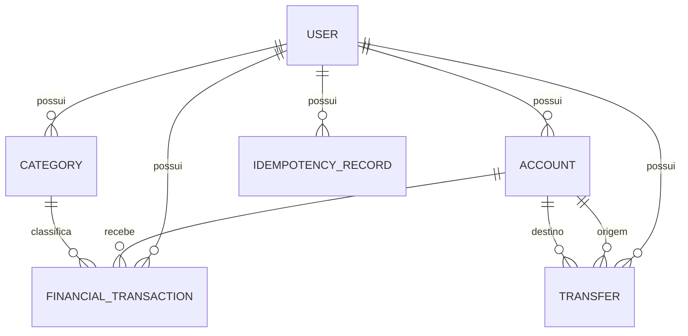

# Modelo de domínio e persistência planejada

Status: especificação aprovada para implementação futura. Fonte das decisões: [ADRs](README.md).

## Entidades e atributos

Ids de negócio serão Guid gerados no servidor. Campos obrigatórios não aceitam nulo; campos opcionais são indicados. Comprimentos abaixo são limites de contrato para implementação, não valores de configuração existentes.

| Entidade | Atributos |
|---|---|
| ApplicationUser | Id, campos Identity, DisplayName (100), IsActive, TokenVersion, CreatedAtUtc |
| FinancialAccount | Id, UserId, Name (100), Type, Currency (BRL), OpeningBalance decimal(18,2), OpeningDate date, IsActive, CreatedAtUtc, UpdatedAtUtc opcional, RowVersion |
| Category | Id, UserId, Name (100), NormalizedName (100), Kind (income/expense), IsActive, timestamps, RowVersion |
| FinancialTransaction | Id, UserId, AccountId, CategoryId, Kind, Amount decimal(18,2), OccurredOn date, Description opcional (500), IsDeleted, DeletedAtUtc opcional, timestamps, RowVersion |
| Transfer | Id, UserId, SourceAccountId, DestinationAccountId, Amount decimal(18,2), OccurredOn date, Description opcional (500), IsCanceled, CanceledAtUtc opcional, timestamps, RowVersion |
| IdempotencyRecord | Id, UserId, Operation, Key (128), RequestHash, status/corpo/Location originais da criação, CreatedAtUtc |

Timestamps técnicos são DateTimeOffset em UTC / SQL datetimeoffset. RowVersion é binário gerenciado pelo SQL Server, não data. Os tipos de conta ainda precisam de vocabulário fechado antes de sua implementação; não presumir cartão de crédito/fatura.

ApplicationUser fica na Infrastructure, com Identity. Domain referencia apenas UserId. IdempotencyRecord é persistência de aplicação, não agregado financeiro. Nenhuma entidade precisa herdar de base genérica.

## Relacionamentos

Todos os recursos de uma relação devem compartilhar o mesmo usuário. Transferência não possui categoria e não gera FinancialTransaction. Não há relacionamento entre usuários para compartilhamento.

## Restrições e índices

| Objeto | Planejamento |
|---|---|
| Usuário | Índice único de e-mail normalizado e configuração de Identity coerente |
| Conta | PK Id; chave alternativa (Id, UserId); índice (UserId, IsActive) |
| Categoria | PK Id; chave alternativa (Id, UserId, Kind); único (UserId, Kind, NormalizedName) |
| Transação → conta | FK (AccountId, UserId) para conta (Id, UserId) |
| Transação → categoria | FK (CategoryId, UserId, Kind) para categoria (Id, UserId, Kind) |
| Transferência → contas | Duas FKs compostas com UserId, para origem e destino |
| Transações | Índices (UserId, AccountId, OccurredOn, Id) e (UserId, CategoryId, OccurredOn) |
| Transferências | Índices (UserId, SourceAccountId, OccurredOn, Id) e equivalente para destino |
| Idempotência | Índice único (UserId, Operation, Key), com comparação exata de chave |
| Valores | CHECK de Amount > 0 e limite; OpeningBalance em intervalo assinado |
| Transferência | CHECK SourceAccountId <> DestinationAccountId |
| Tipos/moeda | CHECK dos valores permitidos, Currency = BRL |

Configurar DeleteBehavior.NoAction nas referências financeiras. Não usar unicidade de descrição/valor/data para detectar duplicação. Categorias desativadas mantêm o nome reservado; pode-se reativar ou renomear com controle de versão. Nome de conta não recebe unicidade sem requisito.

Normalização de categoria deve ser determinística, com trim e política de caixa documentada; alinhar collation/normalização e testar acentos. Chave idempotente é opaca e sensível a diferenças de caracteres; não herdar collation case-insensitive inadvertidamente.

Índices filtrados por não excluído/não cancelado podem ser adotados com base nos planos de consulta. Não criar um índice para cada filtro.

## Invariantes e responsáveis

| Invariante | Domínio | Aplicação | Banco |
|---|---|---|---|
| Valor positivo, limite, centavos | Validação principal | Valida comando | CHECK e precisão |
| Saldo inicial pode ser negativo | Validação do intervalo | Coordena criação | CHECK |
| Mesma propriedade em relações | Coerência das entidades | Autoriza/carrega por usuário | FKs compostas |
| Categoria compatível | Valida tipo | Carrega categoria | FK com Kind |
| Contas distintas na transferência | Valida | Carrega origem/destino | CHECK |
| Abertura e futuro | Valida com data fornecida | Usa relógio e contas | Não usar CHECK dependente de hoje |
| Recursos ativos para novo vínculo | Operação valida estado | Leitura protegida + gravação | Bloqueios transacionais |
| Sem sobrescrita silenciosa | Mudança válida | Precondição HTTP | rowversion |
| Sem duplicação pela mesma chave | — | Hash e replay | Único + transação |
| Transferência conserva patrimônio | Efeitos simétricos | Projeção correta | Registro único |

## Saldos e ciclo de vida

Saldo inicial é imutável. Conta não existe financeiramente antes da abertura; consulta de posição anterior representa zero. Conta inativa permanece nas posições por padrão. Lançamentos anteriores à abertura e futuros são inválidos; retroativos válidos alteram histórico.

FinancialTransaction excluída e Transfer cancelada não compõem saldos. Não há restauração no contrato inicial. Exclusão/cancelamento pode ocorrer com vínculos inativos e altera relatórios passados. Somente descrição pode ser corrigida em transação de conta inativa; novos vínculos e alterações de valor/conta/data exigem atividade conforme ADR-003.

Saldos negativos são permitidos. Transferências não compõem receita/despesa. Extrato tem DTO de movimento com sinais; não são linhas persistidas adicionais.

## Organização da persistência

Um FinanceFlowDbContext integra Identity e finanças, com mapeamento Fluent API por entidade na Infrastructure. Repositórios específicos e consultas retornam modelos definidos na Application, sem IQueryable exposto.

Migrations versionadas, aplicadas explicitamente. Não executar migrations em toda inicialização. Credencial de migration separada da credencial restrita da API. Seed somente opcional em Development, fictício e sem senha fixa versionada.

Consultas AsNoTracking, projeções e agregação no SQL; sem lazy loading ou paginação em memória. Snapshot para respostas multiquery quando necessário, conforme ADR-004. SQL Server real será a referência dos testes de constraints, transações e concorrência.
